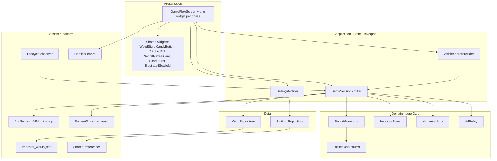
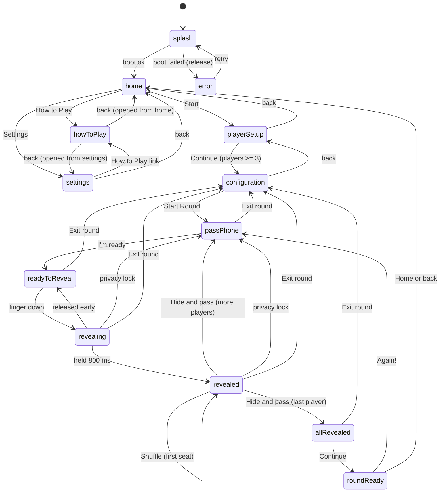

# Find the Imposter — Architecture

Status: **Phase 1, awaiting approval.** Section 12 lists the decisions that need an answer.
Verified against the local toolchain on 2026-11-11: Flutter 3.41.6, Dart 3.11.4.

---

## 1. Overview

Find the Imposter is an offline, single-device, pass-the-phone party game. All game rules live in pure Dart in the domain layer, with randomness and time injected, so every rule can be tested deterministically. One Riverpod `GameSessionNotifier` owns an explicit state machine (`GamePhase`), and one host widget (`GameFlowScreen`) renders whichever phase is current. Secrets reach the UI through a single provider that returns `null` unless the phase is `revealed`. Platform concerns (lifecycle, haptics, ads, secure window) sit behind small interfaces so that tests run without plugins.



**Dependency rule:** `domain/` imports only `dart:*` and `equatable`. It never imports Flutter, Riverpod or a plugin. Widgets contain no game rules.

---

## 2. Folder structure

```
lib/
  main.dart                         ProviderScope, orientation lock, runApp
  app/
    app.dart                        MaterialApp, themeMode, home: GameFlowScreen
    theme/
      app_colors.dart               colour tokens (§0.6)
      app_typography.dart           Nunito scale
      app_spacing.dart              spacing, radii, min tap sizes
      app_theme.dart                light/dark chrome ThemeData
  core/
    ads/
      ad_config.dart                unit IDs from dart-defines, sample IDs in debug/profile
      ad_placement.dart             whitelist of phases that may show a banner
      ads_service.dart              interface
      admob_ads_service.dart        google_mobile_ads implementation
      noop_ads_service.dart         tests and failure fallback
      ad_banner.dart                the only widget that renders a banner
    haptics/haptics_service.dart    respects the Haptics setting
    lifecycle/privacy_lock_observer.dart
    security/secure_window.dart     MethodChannel to native secure flag (D4)
    utils/
      game_random.dart              wrapper over dart:math Random
      clock.dart                    typedef Clock = DateTime Function()
      motion.dart                   animations-enabled helper for flutter_animate
  features/
    game/
      domain/
        entities/   player.dart, word_entry.dart, player_assignment.dart,
                    round.dart, game_settings.dart, game_session.dart
        enums/      role.dart, difficulty.dart, game_phase.dart, app_theme_mode.dart
        ad_policy.dart
        imposter_rules.dart
        name_validator.dart
        round_generator.dart
        word_pack_validator.dart
      data/
        word_repository.dart
        settings_repository.dart
        dto/word_entry_dto.dart
      application/
        game_session_notifier.dart
        settings_notifier.dart
        providers.dart              DI providers, visibleSecretProvider
      presentation/
        game_flow_screen.dart       switches on session.phase, owns PopScope
        phases/  splash_phase.dart, home_phase.dart, player_setup_phase.dart,
                 configuration_phase.dart, pass_phone_phase.dart,
                 reveal_phase.dart, all_revealed_phase.dart,
                 round_ready_phase.dart, error_phase.dart
        widgets/ player_list_tile.dart, difficulty_chip.dart,
                 imposter_stepper.dart, exit_round_dialog.dart
    settings/presentation/settings_phase.dart
    how_to_play/presentation/how_to_play_phase.dart
  shared/widgets/
    wood_sign.dart  candy_button.dart  stitched_pill.dart
    secret_reveal_card.dart  spark_burst.dart  illustrated_scaffold.dart
assets/
  data/imposter_words.json
  images/backgrounds/  images/ui/  images/mascot/  images/icon/
  fonts/Nunito/
tool/
  build_words.dart                  word pack generator and validator
  check_release_config.sh           CI guard for ad IDs
docs/
  ARCHITECTURE.md  QA.md  wireframes/  assets/
test/
  domain/  data/  application/  presentation/  helpers/
```

`reveal_phase.dart` deliberately serves three phases (`readyToReveal`, `revealing`, `revealed`). A single mounted widget keeps the hold `AnimationController` and the flip alive across those transitions. This is the one exception to "one widget per phase", and §5.3 explains why it is required.

---

## 3. Entities

All entities are immutable, extend `Equatable`, and expose `copyWith` where they change. Collections are unmodifiable.

### `Player(id, name, position)`
- `id`: UUID v4, stable for the session.
- `name`: trimmed, 1–20 characters.
- `position`: 0-based insertion index, re-packed on removal so positions stay contiguous.

### `WordEntry(id, difficulty, category, word, hint, tags)`
- `id` is globally unique (`easy_001`).
- `word`, `hint` and `category` are non-empty.
- `hint` never contains `word`, case-insensitive.

### `enum Role { civilian, imposter }`

### `enum Difficulty { easy, medium, hard }`

### `PlayerAssignment(playerId, role, word?, hint?)`
- Civilian: `word != null`, `hint == null`.
- Imposter: `word == null`. `hint != null` if and only if the round was generated with hints on.

### `Round(secretWord, difficulty, orderedPlayers, assignments, imposterIds, startingPlayerId)`
- `secretWord` is a `WordEntry`, because its `id` feeds the history and its `hint` feeds assignments.
- `orderedPlayers` is a rotation of insertion order.
- `assignments` is a `Map<String, PlayerAssignment>` with exactly one entry per player.
- `imposterIds` is a `Set<String>` with size ≥ 1, and it excludes `orderedPlayers.first` when shuffle is on.
- `startingPlayerId` is any player.

### `GameSettings`
`difficulties: Set<Difficulty>` (never empty), `imposterCount: int` (the player's requested count), `showHint`, `themeMode`, `sound`, `haptics`, `animations`, `allowDuplicateNames`, `wordShuffle`.

### `GameSession`
| Field | Type | Invariant |
|---|---|---|
| `phase` | `GamePhase` | |
| `players` | `List<Player>` | length ≤ 20 |
| `settings` | `GameSettings` | mirror of `SettingsNotifier` |
| `round` | `Round?` | non-null exactly in `passPhone` through `roundReady` |
| `currentPlayerIndex` | `int` | valid index into `round.orderedPlayers` while a round exists |
| `isRevealed` | `bool` | true if and only if `phase == revealed` |
| `privacyLocked` | `bool` | true only in `passPhone`, cleared by `confirmReady` |
| `roundsCompleted` | `int` | counts arrivals at `roundReady` this app run |
| `lastFirstPlayerId` | `String?` | survives exit-round and Home |
| `recentWordIds` | `List<String>` | oldest first, length ≤ 20 |
| `howToPlayReturnPhase` | `GamePhase` | *added to the spec's list:* How to Play opens from Home or Settings and must return there |
| `isAdvancing` | `bool` | *added:* blocks double taps on Again! while an interstitial is up |

Derived getter: `effectiveImposterCount = ImposterRules.clamp(settings.imposterCount, players.length, settings.wordShuffle)`. The clamp is derived rather than written back. An empty player list on launch therefore cannot overwrite a saved preference of 3, and adding or removing players re-clamps automatically. Tapping the stepper persists the new value.

### `enum GamePhase`
`splash, home, howToPlay, playerSetup, configuration, passPhone, readyToReveal, revealing, revealed, allRevealed, roundReady, settings, error`

Helper: `isRevealFlow` is true for `passPhone, readyToReveal, revealing, revealed, allRevealed`.

---

## 4. State machine



| From | Event | Guard | To | Side effects |
|---|---|---|---|---|
| `splash` | boot ok | pack valid, settings loaded, 1.4 s elapsed | `home` | store pack; start ads bootstrap, not awaited |
| `splash` | boot failed | release mode | `error` | debug mode rethrows instead |
| `error` | `retryLoad` | | `splash` | re-run boot |
| `home` | `startGame` | | `playerSetup` | |
| `home` | `openHowToPlay` | | `howToPlay` | return phase = `home` |
| `home` | `openSettings` | | `settings` | |
| `settings` | `openHowToPlay` | | `howToPlay` | return phase = `settings` |
| `settings` | `goBack` | | `home` | |
| `howToPlay` | `goBack` | | return phase | |
| `playerSetup` | `addPlayer` / `removePlayer` | validator passes | `playerSetup` | positions re-packed; clamp re-derives |
| `playerSetup` | `continueToConfig` | players ≥ 3 | `configuration` | |
| `playerSetup` | `goBack` | | `home` | players kept |
| `configuration` | `goBack` | | `playerSetup` | |
| `configuration` | `startRound` | players ≥ 3 | `passPhone` | generate round; index 0; record first player; push word to history; enable secure window |
| `passPhone` | `confirmReady` | | `readyToReveal` | `privacyLocked = false` |
| `readyToReveal` | `beginHold` | | `revealing` | |
| `revealing` | `cancelHold` | | `readyToReveal` | |
| `revealing` | `completeReveal` | | `revealed` | `isRevealed = true` |
| `revealed` | `shuffleWord` | shuffle on, index 0 | `revealed` | new word and hint; imposters and order unchanged; push to history |
| `revealed` | `hideAndPass` | index < last | `passPhone` | index + 1; `isRevealed = false` |
| `revealed` | `hideAndPass` | index = last | `allRevealed` | `isRevealed = false`; disable secure window |
| `revealing`, `revealed` | lifecycle `inactive`/`paused`/`hidden` | | `passPhone` | `privacyLocked = true`; `isRevealed = false`; same index |
| any reveal-flow phase | `exitRound` | confirmed in dialog | `configuration` | round cleared; index 0; disable secure window; **not** counted as completed |
| `allRevealed` | `finishReveals` | | `roundReady` | `roundsCompleted + 1`; preload interstitial |
| `roundReady` | `again` | not advancing | `passPhone` | show interstitial **first** if policy allows, await dismissal, then generate as in `startRound` |
| `roundReady` | `goHome` | | `home` | round cleared; players kept |

Any event not in this table is a no-op. Each notifier method begins with a phase guard, so stale callbacks (a hold timer finishing after a privacy lock, say) cannot corrupt state.

**Back button.** `GameFlowScreen` is the only route, and its `PopScope` routes system back by phase. `canPop` is true only on `home` and `splash`/`error`, so the app can exit from those. Reveal-flow phases open the exit-round dialog. `roundReady` goes Home. All others call `goBack`.

---

## 5. State management

`flutter_riverpod` 3.x, hand-written `Notifier`s, no code generation. The state surface is two notifiers, so generated providers would add a build step and save almost nothing.

### 5.1 `GameSessionNotifier extends Notifier<GameSession>`

Constructor-free. Collaborators come from providers that tests override: `wordRepositoryProvider`, `gameRandomProvider`, `clockProvider`, `adsServiceProvider`, `secureWindowProvider`.

| Method | Behaviour |
|---|---|
| `Future<void> boot()` | Waits for pack, settings and the 1.4 s minimum in parallel. Moves to `home`, or `error` in release |
| `Future<void> retryLoad()` | From `error`, back to `splash`, then `boot()` |
| `void startGame()` | Home to `playerSetup` |
| `void openHowToPlay()` / `void openSettings()` | Open those phases, recording the return phase |
| `void goBack()` | Non-reveal back navigation from the table |
| `NameError? addPlayer(String raw)` | Validates and appends. Returns the error for the UI, or `null` |
| `void removePlayer(String id)` | Removes and re-packs positions |
| `void continueToConfig()` | Guarded at ≥ 3 players |
| `void startRound()` | Generates a round and enters `passPhone` |
| `void confirmReady()` | `passPhone` to `readyToReveal` |
| `void beginHold()` | `readyToReveal` to `revealing` |
| `void cancelHold()` | `revealing` to `readyToReveal` |
| `void completeReveal()` | `revealing` to `revealed` |
| `void shuffleWord()` | First seat only. Replaces the word |
| `void hideAndPass()` | Next player or `allRevealed` |
| `void finishReveals()` | `allRevealed` to `roundReady` |
| `Future<void> again()` | Ad gate, then a new round |
| `void goHome()` | `roundReady` to `home` |
| `void exitRound()` | Reveal flow to `configuration` |
| `void onAppLifecycleChanged(AppLifecycleState s)` | Privacy lock (§8) |

After any `await`, methods check `ref.mounted` and re-check the phase. Word-pack loading uses an explicit `boot()` rather than an `AsyncNotifier` build, because the spec makes loading a visible phase with its own retry. It also avoids Riverpod 3's automatic retry of failed providers.

### 5.2 `SettingsNotifier extends Notifier<GameSettings>`

Loaded during boot, write-through to `SettingsRepository`. Methods: `toggleDifficulty` (refuses to remove the last one), `setImposterCount`, `setShowHint`, `setThemeMode`, `setSound`, `setHaptics`, `setAnimations`, `setAllowDuplicateNames`, `setWordShuffle`, `reset`. `GameSessionNotifier` mirrors it with `ref.listen`. Settings can only be opened from Home, so settings cannot change during a round.

### 5.3 Secret containment

`AnimatedSwitcher` keeps the **outgoing** child on screen during a cross-fade, which creates two hazards that the design closes:

1. **Secret on the next screen.** `SecretRevealCard` gets its content only from `visibleSecretProvider`, which returns `null` unless `phase == revealed`. Because the card is a consumer, an outgoing card rebuilds face-down immediately. In addition, the switcher uses a zero duration for any transition that leaves `revealed`.
2. **Hold state destroyed mid-gesture.** `readyToReveal`, `revealing` and `revealed` share one `ValueKey`, so the switcher does not replace the widget between them.

The same outgoing-child problem applies to banners (§9.3).

### 5.4 Hold to reveal

`Listener` (`onPointerDown`, `onPointerUp`, `onPointerCancel`) drives an 800 ms `AnimationController`. See decision D3 for why this replaces the long-press recognizer. Haptics: `lightImpact` on start, `selectionClick` when value crosses 0.5, `mediumImpact` on completion. Only the first pointer counts. The flip is a 520 ms Y-rotation and swaps content at 90°. With animations off, the swap is instant.

---

## 6. RoundGenerator (pure Dart)

```dart
class RoundGenerator {
  RoundGenerator(GameRandom random);
  GeneratedRound generate({required List<Player> players, required GameSettings settings,
      required int imposterCount, required List<WordEntry> pack,
      String? lastFirstPlayerId, required List<String> recentWordIds});
  GeneratedRound replaceWord({required Round round, required GameSettings settings,
      required List<WordEntry> pack, required List<String> recentWordIds});
}
// GeneratedRound = (Round round, List<String> recentWordIds)
```

**Reveal order**
```
sorted = players by position
candidates = sorted
if sorted.length >= 2 and lastFirstPlayerId is in sorted:
    candidates = sorted without lastFirstPlayerId
first = random element of candidates
k = index of first in sorted
return sorted[k..] + sorted[..k]
```

**Imposter selection**
```
eligible = shuffleOn ? ordered[1..] : ordered
count = min(requested, eligible.length)
Fisher-Yates shuffle a copy of eligible with injected random
return ids of first `count`
```

**Max imposters** (`ImposterRules`)
```
maxFor(n, shuffleOn):
    base = max(1, n ~/ 3)
    eligible = shuffleOn ? n - 1 : n
    return max(1, min(base, eligible))
clamp(requested, n, shuffleOn) = requested.clamp(1, maxFor(n, shuffleOn))
```

**Word pick**
```
pickWord(pack, difficulties, history, excludeId?):
    d = random element of difficulties
    pool = pack where difficulty == d and id != excludeId
    if pool is empty: throw StateError        // impossible with a validated pack
    h = copy of history
    loop:
        available = pool where id not in h
        if available not empty: break
        drop = max(1, ceil(h.length / 2))     // always progresses, even at length 1
        remove the oldest `drop` from h
    w = random element of available
    return (w, last 20 of h + w.id)
```

**Assignments**
```
for each player p:
    if p.id in imposterIds:
        PlayerAssignment(p.id, imposter, word: null, hint: showHint ? w.hint : null)
    else:
        PlayerAssignment(p.id, civilian, word: w.word, hint: null)
```

**Shuffle / replace word**
```
(w, history) = pickWord(pack, difficulties, recentWordIds, excludeId: round.secretWord.id)
rebuild assignments with the same imposterIds
return round.copyWith(secretWord: w, difficulty: w.difficulty, assignments: rebuilt)
// orderedPlayers, imposterIds and startingPlayerId are untouched
```

`excludeId` guarantees that Shuffle really changes the word even if the exhaustion fallback has just dropped the current word from history.

**Starting speaker**
```
random element of all players, drawn independently of imposter selection
```

---

## 7. Data layer

### Word pack
`WordRepository.load()` reads `assets/data/imposter_words.json` (a top-level JSON array) via `AssetBundle`, parses into DTOs, and runs `WordPackValidator`, which requires:
- 900 entries: 400 easy, 300 medium, 200 hard
- unique IDs and an `id` prefix matching `difficulty`
- non-empty `word`, `hint`, `category`
- `hint` does not contain `word`

Any failure throws `WordPackException(reasons)`. The repository behaves the same in every build mode. The mode split is in `boot()`: it rethrows when the injected `rethrowBootErrors` is true (default `kDebugMode`) and otherwise enters `error`. Tests can exercise both paths.

### Settings keys

| Key | Type | Default |
|---|---|---|
| `settings.difficulties` | `List<String>` | `['easy']` |
| `settings.imposterCount` | `int` | `1` |
| `settings.showHint` | `bool` | `false` |
| `settings.themeMode` | `String` | `system` |
| `settings.sound` | `bool` | `false` |
| `settings.haptics` | `bool` | `true` |
| `settings.animations` | `bool` | `true` |
| `settings.allowDuplicateNames` | `bool` | `false` |
| `settings.wordShuffle` | `bool` | `true` |

Unknown or corrupt values fall back to the default for that key, and an empty difficulty set falls back to `{easy}`. `reset()` removes only these keys. Sound is a stored stub with no audio.

---

## 8. Privacy lock

`PrivacyLockObserver` is a `WidgetsBindingObserver`, mounted in `GameFlowScreen`, that forwards every lifecycle change to `onAppLifecycleChanged`.

- **Triggers:** `inactive`, `paused`, `hidden`, and only while the phase is `revealing` or `revealed`. `resumed` does nothing; the player must go through "I'm ready" again.
- **Reset:** `phase = passPhone`, `isRevealed = false`, `privacyLocked = true`. The hold controller is cancelled and the flip reset. `currentPlayerIndex`, `round`, assignments and word history are retained, so the secret is unchanged when that player re-reveals.
- **Instant cover:** the phase change makes `visibleSecretProvider` return `null` in the same frame, and the zero-duration transition applies.
- **App-switcher snapshot:** Dart cannot guarantee a frame is drawn before the OS takes its snapshot, so a Flutter-only cover is best-effort. Native protection is proposed in D4.
- **Exit dialog:** its barrier is near-opaque (navy at 92 %), so an open dialog does not leave a secret readable behind it.
- **Interstitials** also trigger lifecycle events, but only appear on `roundReady`, where the lock is inactive.

---

## 9. Ads

### 9.1 `AdPolicy` (pure)
```dart
class AdPolicy {
  AdPolicy({required Clock now, int everyNRounds = 4, Duration cooldown = const Duration(seconds: 90)});
  bool shouldShowInterstitial(int roundsCompleted);  // n > 0 && n % every == 0 && cooldown elapsed
  void recordShown();
}
```
Only a successfully displayed ad starts the cooldown. See D7 for how a missed slot behaves.

### 9.2 `AdsService`
```dart
abstract interface class AdsService {
  Future<void> initialize();                 // UMP, then Mobile Ads
  bool get canRequestAds;
  Future<bool> get privacyOptionsRequired;
  Future<void> showPrivacyOptions();
  Future<void> preloadInterstitial();
  Future<bool> showInterstitial();           // completes on dismissal; false if none ready
}
```
`AdMobAdsService` is the real implementation. `NoopAdsService` is used in tests and as the fallback if initialization throws.

### 9.3 Phase gating
- `AdPlacement.bannerPhases = {home, roundReady}` is the single whitelist.
- `AdBanner` is the only widget that creates a `BannerAd`. `IllustratedScaffold(showBanner: true)` hosts it through a consumer that watches the live phase and builds nothing outside the whitelist. An outgoing `roundReady` screen therefore drops its banner at once, rather than showing it over `passPhone` during the cross-fade.
- The interstitial is called only from `again()`, and it is awaited **before** the phase leaves `roundReady`.

### 9.4 UMP flow
1. After the first frame, not blocking boot: `requestConsentInfoUpdate` with a 5 s timeout.
2. A consent form may be shown only while the phase is `splash` or `home`. If the player has already moved on, the form waits for the next Home, so it can never interrupt a reveal.
3. If `canRequestAds`, initialize Mobile Ads and load banners.
4. Offline, or on any failure: no ads, and the game stays fully playable.
5. iOS tracking transparency is handled by the UMP message configured in the AdMob console, plus `NSUserTrackingUsageDescription` in `Info.plist`.

### 9.5 Release guard
A Dart exception only fires when the app runs, so on its own it cannot make `flutter build` fail as §4.5 requires. The guard therefore has four layers:

1. **Android, build time:** `android/app/build.gradle.kts` decodes the `dart-defines` Gradle property (which also carries `--dart-define-from-file` values) and fails any release task if an ID is missing, is a placeholder, uses Google's sample publisher ID, or does not match the `ca-app-pub-…` format. The same values fill the manifest App ID through `manifestPlaceholders`.
2. **iOS, build time:** an Xcode Run Script phase does the same for `Release` using `DART_DEFINES`, and writes `GADApplicationIdentifier` into the built `Info.plist`.
3. **Dart, startup:** `AdConfig.assertReleaseReady()` throws in release mode as a last defence.
4. **CI:** `tool/check_release_config.sh` validates `env.json`.

Debug and profile always use Google's sample IDs. `env.example.json` is committed and `env.json` is ignored.

---

## 10. Packages

Resolved together with `flutter pub get` against Flutter 3.41.6.

| Package | Constraint | Reason |
|---|---|---|
| `flutter_riverpod` | `^3.3.2` | State management. 3.3.2 is the newest that supports Dart 3.11; 3.4 and later need Dart 3.12 |
| `shared_preferences` | `^2.5.6` | Persist settings |
| `uuid` | `^4.6.0` | Stable player IDs, needed when duplicate names are allowed |
| `flutter_animate` | `^4.5.2` | Declarative motion |
| `google_mobile_ads` | `^9.2.0` | Banners, interstitials and UMP in one plugin |
| `equatable` | `^3.0.0` | Value equality without code generation |
| *dev:* `flutter_launcher_icons` | `^0.14.4` | Generate app icons |
| *dev:* `flutter_native_splash` | `^2.4.7` | Native splash. 2.4.8 needs a newer `meta` than this SDK pins |
| *dev:* `flutter_lints` | `^6.0.0` | Lint rules |
| *dev:* `mocktail` | `^1.0.5` | Test doubles |

**`equatable` over `freezed`:** there are about six small entities, and `freezed` would add `build_runner` and generated files to the repository. A handful of hand-written `copyWith` methods is cheaper.

---

## 11. Testing strategy

**Unit (`test/domain`, `test/data`, `test/application`)**, using seeded `GameRandom` and a fake clock:
- Reveal order is a rotation, and the first player differs from the previous round across 1,000 seeded runs
- `maxFor`, clamp on add/remove, protected first seat with shuffle on, first seat can be imposter with shuffle off
- Assignments for civilians, imposters, hint on and off
- Shuffle changes word and hint while imposters and order stay identical
- Name validation: empty, whitespace, over 20 characters, case-insensitive duplicates, allowed with the setting, 20-player cap
- Difficulty: never empty, picks only from selected, history rule, exhaustion fallback including history of length 1
- Word pack: valid, wrong counts, duplicate IDs, empty fields, hint containing word, error vs rethrow
- `AdPolicy`: every 4th round, 90 s cooldown
- Notifier: happy path, Again!, exit round, privacy lock from `revealing` and `revealed`, stale events ignored

**Widget (`test/presentation`)**, with `NoopAdsService` and fake haptics:
- Hold under 800 ms does not reveal, hold of 800 ms or more does
- Shuffle only on the first seat with shuffle on
- No `AdBanner` in any reveal-flow phase, including during the `roundReady` to `passPhone` transition
- No secret text in the tree outside `revealed`, including during transitions
- Continue disabled below 3 players
- 1.3× text scale without overflow on key screens

**Manual QA (`docs/QA.md`):** hold cancel, backgrounding and app-switcher snapshot, shuffle only for first player, Again! deals new word, imposters and first player, ads never mid-reveal, airplane mode, animations off, haptics off, 3 and 20 players, long names, dark-mode chrome.

---

## 12. Risks and open decisions

### Decisions needed

**D1. Project identity.** The prompt assumed an empty folder and says to run `flutter create --org com.lazybearclub --project-name find_the_imposter`. The folder already has an untouched Flutter template named `imposter_fun_game`, with ID `com.the_lazy_bear_club.imposter_fun_game` and desktop and web folders. The ID cannot change once the app is published.
*Recommendation:* follow the prompt and use `com.lazybearclub.find_the_imposter`, renaming the package and removing `linux/`, `macos/`, `web/` and `windows/`. If `com.the_lazy_bear_club` is your real organisation ID, tell me and I'll use it instead.

**D2. Android minimum SDK (spec conflict).** The prompt says Android 23+, but Flutter 3.41 defaults to 24 and `google_mobile_ads` 9.2.0 declares `minSdk 24`.
*Recommendation:* use **24**. Supporting 23 would mean downgrading the ad SDK and overriding Flutter's supported floor, for a very small share of devices.

**D3. Hold gesture (spec conflict).** §4.1.7 asks for a `GestureDetector` long-press with an 800 ms controller. Flutter's long-press only fires after 500 ms, so progress and the first haptic would start late and a full reveal would take about 1.3 s. That contradicts "hold ~800 ms" and the acceptance test.
*Recommendation:* use a `Listener` on raw pointer events. Progress starts on touch, and small finger movement doesn't cancel the hold.

**D4. App-switcher protection.** §4.1.8 says the snapshot must **never** show a secret, but a Flutter-drawn cover can lose the race with the OS.
*Recommendation:* add a small native channel with no new package. On Android, set `FLAG_SECURE` during the reveal flow. On iOS, add a native cover view on resign-active. As a side effect, Android screenshots and screen recordings are black during reveals. A debug-only define will turn it off for QA screenshots.

### Defaults I'll use unless you say otherwise

- **D5. Player names** stay in memory across Home and Again!, but are not saved between app launches.
- **D6. Allow duplicates switched off** while duplicates exist: existing names stay and only new entries are validated.
- **D7. Missed interstitial slot:** literal rule, `roundsCompleted % 4 == 0` and cooldown elapsed. If round 4 is inside the cooldown, the next chance is round 8.
- **D8. WoodSign** is a 9-slice PNG plus rope PNG rather than code, so final art swaps in with no code changes.
- **D9. Settings screen** holds the app-wide toggles. Difficulty, imposter count and hint are edited on Configuration and persisted from there.

### Risks

- **Toolchain for Phase 4:** Android licenses aren't accepted on this machine (`flutter doctor --android-licenses`), which can block Android builds and emulator runs.
- **Release signing:** the template signs release builds with the debug key. A store build needs your keystore.
- **Inactive sensitivity:** iOS `inactive` fires for Control Center and notification pulls, so those will lock a visible card. This is what the spec asks for and is the safe behaviour.
- **Word pack quality:** 900 entries with hints is a large content job. The script can enforce structure, but family-friendliness and hint quality need a human skim.
- **Consent setup:** UMP forms only appear once a message is published in the AdMob console.
